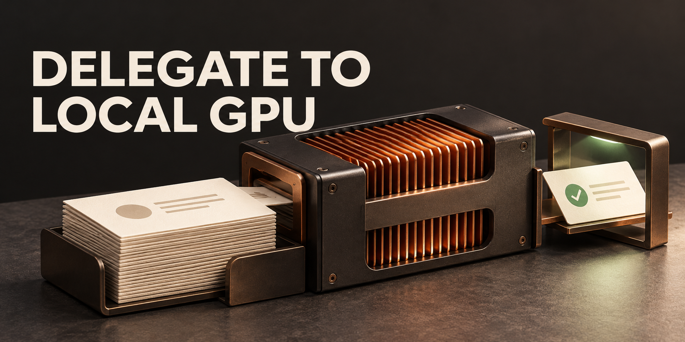

<!-- project-home:start -->

**[Delegate to Local GPU project homepage](https://lewfkrad.github.io/delegate-local-gpu/)** · [Documentation](https://github.com/lEWFkRAD/delegate-local-gpu/blob/main/SKILL.md)

A skill for local-model preprocessing with verification owned by the coordinating agent.

<!-- project-home:end -->
